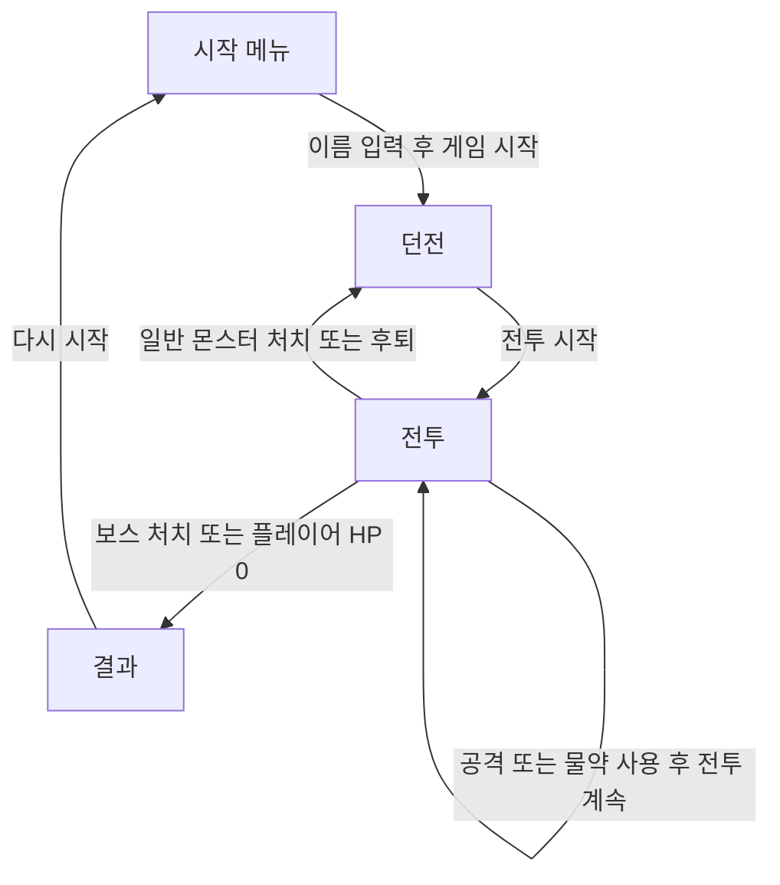

# 수정 동굴 RPG

Java Swing으로 화면을 구현하는 3층 턴제 RPG입니다. 플레이어는 이름을 입력하고 동굴에 들어가 층마다 몬스터와 싸웁니다. 3층 보스를 쓰러뜨리면 클리어되고, 플레이어 체력이 0이 되면 패배합니다.

백엔드 7개 클래스는 `src/rpg/backend/`에 구현되어 있습니다. 프론트 담당자는 `src/rpg/frontend/`에 아래 7개 클래스를 구현하면 됩니다. 전체 목표는 **백엔드 7개 + 프론트엔드 7개 = 총 14개 클래스**입니다. 백엔드의 `Usable`은 인터페이스이므로 과제의 클래스 수에서 제외합니다.

개발 환경은 Java 11 이상이며, Java 소스 파일은 UTF-8로 저장합니다. Swing 창과 화면은 `SwingUtilities.invokeLater()`에서 초기화합니다.

## 화면과 클래스 역할

| 클래스 | 담당 화면 또는 기능 | 구현할 내용 |
| --- | --- | --- |
| `RpgApp` | 실행 진입점 | `main()`에서 Swing 창을 열고, 컨트롤러와 화면을 연결해 시작 메뉴를 띄웁니다. |
| `GameController` | UI와 백엔드 연결 | 현재 `GameEngine`을 보관합니다. 버튼 입력에 맞는 메서드를 호출하고, 결과와 예외 메시지를 화면에 전달합니다. |
| `MainMenuPanel` | 시작 메뉴 | 이름 입력란과 **게임 시작** 버튼을 제공합니다. 이름 입력에 문제가 있으면 메시지를 표시하고 현재 화면을 유지합니다. |
| `DungeonPanel` | 층 진입 대기 화면 | 현재 층, 이름, **현재/최대 HP**, 레벨, **현재/필요 경험치**를 표시합니다. **전투 시작** 버튼을 제공합니다. |
| `BattlePanel` | 전투 화면 | 플레이어 HP, 몬스터 이름과 HP, **공격**·**후퇴** 버튼, 전투 로그를 표시합니다. `InventoryPanel`을 여기에 배치합니다. |
| `InventoryPanel` | 물약 선택 영역 | 아이템 목록과 **사용** 버튼을 제공합니다. 선택한 항목의 인덱스를 컨트롤러에 전달합니다. |
| `ResultPanel` | 결과 화면 | **던전 클리어** 또는 **게임 오버**를 표시합니다. **다시 시작**을 누르면 시작 메뉴로 돌아갑니다. |

## 화면 전환

새 게임을 시작할 때 `new GameEngine(name)`을 한 번 호출합니다. 같은 게임에서는 던전과 전투 화면을 오갈 때 그 인스턴스를 계속 사용합니다. 다시 시작한 뒤 이름을 제출하면 새 인스턴스가 만들어집니다.

## 게임 규칙

- 플레이어는 **레벨 1, HP 60, 회복 물약 2개**로 시작합니다.
- **공격**을 누르면 0~6 주사위 눈에 `현재 레벨 - 1`을 더해 몬스터에게 피해를 줍니다. 예를 들어 레벨 2에서 주사위가 4면 공격값은 5입니다.
- 몬스터가 살아 있으면 **반격**합니다. 몬스터 공격과 플레이어 방어를 각각 0~6으로 굴리고, `max(0, 몬스터 공격 - 플레이어 방어)`만큼 플레이어가 피해를 받습니다. 방어 주사위는 이때 자동으로 굴립니다.
- **물약**은 최대 HP를 넘지 않는 범위에서 HP를 4 회복하고, 사용 직후 몬스터가 반격합니다. 이미 최대 HP여도 사용하면 물약이 소비되고 반격을 받습니다.
- **후퇴**하면 같은 층의 던전 화면으로 돌아갑니다. 플레이어의 HP와 소지품이 이어지며, 다시 진입하면 해당 층의 몬스터가 최대 HP로 등장합니다. 보스전에서는 후퇴가 금지됩니다.
- 일반 몬스터를 처치하면 경험치를 받고 다음 층이 열립니다. 다음 레벨에 필요한 경험치는 `현재 레벨 × 20`이고, 레벨업 시 최대 HP와 현재 HP가 각각 10 증가합니다.

| 층 | 몬스터 | 최대 HP | 처치 경험치 |
| --- | --- | ---: | ---: |
| 1층 | 동굴 슬라임 | 24 | 20 |
| 2층 | 유적 파수꾼 | 36 | 25 |
| 3층 | 수정 수호자 | 60 | 35 |

## 백엔드 연동

프론트 패키지에서 `import rpg.backend.GameEngine;`으로 가져옵니다. 게임 상태는 컨트롤러가 `GameEngine`에서 조회하고 각 패널에 전달합니다. 주사위, 피해, 회복, 경험치는 모두 백엔드에서 처리합니다.

### 버튼과 행동 메서드

| 사용자 행동 | 호출 | 반환값과 처리 |
| --- | --- | --- |
| 게임 시작 | `new GameEngine(name)` | 새 게임을 저장하고 던전 화면을 표시합니다. |
| 전투 시작 | `startBattle()` | 조우 메시지 `String`을 받아 전투 로그 첫 줄에 표시합니다. |
| 공격 | `attack()` | `List<String>`을 순서대로 로그에 추가합니다. 공격·반격과 함께 처치, 레벨업, 승패 메시지가 들어올 수 있습니다. |
| 물약 사용 | `useItem(slot)` | `List<String>`을 순서대로 표시하고 HP와 아이템 목록을 다시 조회합니다. |
| 후퇴 | `flee()` | 후퇴 메시지 `String`을 받아 던전 화면에 표시합니다. |

### 화면에 표시할 상태

| 화면 정보 | 조회 메서드 |
| --- | --- |
| 현재 층 / 마지막 층 | `getFloor()` / `GameEngine.TOTAL_FLOORS` |
| 플레이어 이름 / 레벨 | `getPlayerName()` / `getPlayerLevel()` |
| 플레이어 현재 HP / 최대 HP | `getPlayerHp()` / `getPlayerMaxHp()` |
| 현재 레벨에서 쌓은 경험치 / 다음 레벨 기준 | `getPlayerExperience()` / `getExperienceToLevelUp()` |
| 몬스터 이름 / 현재 HP / 최대 HP | `getEnemyName()` / `getEnemyHp()` / `getEnemyMaxHp()` |
| 보스 전투 여부 | `isBossBattle()` |
| 인벤토리 목록 | `getItemNames()` |
| 전투 진행 / 게임 종료 / 클리어 | `hasActiveBattle()` / `isGameOver()` / `isCleared()` |

### 턴 후 갱신 순서

1. `attack()` 또는 `useItem(slot)`을 호출하고, 반환된 메시지를 순서대로 표시합니다. 로그에는 주사위 눈과 실제 피해가 포함됩니다.
2. `isGameOver()`가 참이면 `isCleared()`로 클리어와 패배를 구분해 결과 화면을 표시합니다.
3. 게임이 계속되고 `hasActiveBattle()`가 거짓이면 던전 화면을 표시합니다. 일반 몬스터를 처치한 경우 `getFloor()`에 이미 다음 층이 반영되어 있습니다.
4. 전투가 진행 중이면 양쪽 HP와 아이템 목록을 다시 읽어 전투 화면을 갱신합니다. **몬스터 정보와 보스 여부는 전투가 진행 중일 때만** 조회할 수 있습니다.

마지막 공격이나 물약 사용으로 곧바로 화면을 전환하는 경우, 다음 화면에도 해당 턴의 메시지를 전달해 처치·레벨업·패배 로그를 읽을 수 있게 합니다. 화면 전환은 상태 조회 메서드로 결정하고, 반환된 로그는 표시용으로 사용합니다.

물약 슬롯은 **0부터** 시작합니다. 예를 들어 Swing `JList`의 `getSelectedIndex()`가 `0`이면 `useItem(0)`을 호출합니다. 물약을 쓰면 목록에서 빠지고 뒤의 항목이 앞으로 이동하므로, 매번 `getItemNames()`로 갱신합니다. 목록이 비었거나 선택이 없으면 **사용** 버튼을, 보스전에서는 **후퇴** 버튼을 비활성화합니다.

### 예외 처리

컨트롤러에서 해당 예외의 `getMessage()`를 현재 화면의 안내 메시지나 대화 상자에 표시합니다.

| 예외 | 발생 조건 |
| --- | --- |
| `IllegalArgumentException` | 캐릭터 이름이 없거나 공백만 입력한 경우 |
| `IllegalStateException` | 전투가 없는데 공격·물약·후퇴 또는 몬스터 정보 조회를 시도하거나, 이미 전투 중이거나 종료된 게임에서 전투를 시작한 경우 |
| `NoSuchElementException` | 인벤토리가 비어 있는 상태에서 물약을 사용한 경우 |
| `IndexOutOfBoundsException` | 아이템 목록 범위를 벗어난 슬롯을 전달한 경우 |
| `UnsupportedOperationException` | 보스 전투에서 후퇴를 시도한 경우 |

## 연동 확인

- [ ] 공백 이름을 입력하면 메시지가 표시되고, 정상 이름을 입력하면 1층, HP `60/60`, 레벨 1로 시작한다.
- [ ] 1층 공격 로그에서 주사위 눈과 레벨 보너스가 보이고, 반격 후 HP가 갱신된다.
- [ ] 1층 승리 후 2층과 레벨 2가 표시되고, 다음 전투에서 공격 보너스 `+1`을 확인할 수 있다.
- [ ] 물약을 쓰면 회복 및 반격 로그가 순서대로 표시되고, 목록이 1개 줄어든다.
- [ ] 일반 전투에서 후퇴 후 같은 층에 다시 진입할 수 있고, 보스전에서는 후퇴할 수 없다.
- [ ] 보스 처치와 플레이어 패배가 서로 다른 결과로 표시되고, 다시 시작하면 새 이름을 입력할 수 있다.
